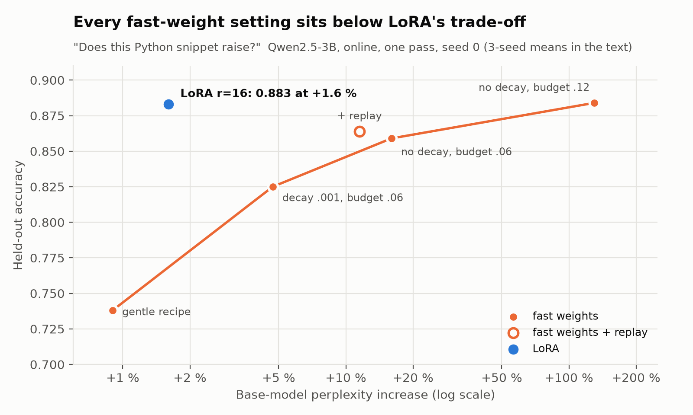
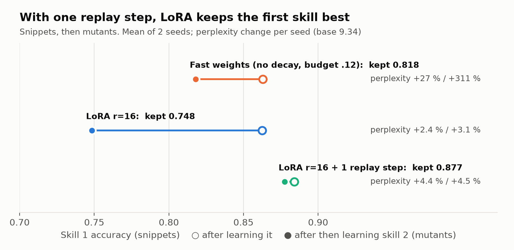

# I gave an LLM fast weights so it could learn on the job. LoRA with replay won.

*MaxGR*

*A month of experiments on one 16 GB GPU, with a 3B model learning online from its own
verified work. The negative result, plus the parts of the system that held up. This is my
first independent research project, and most of the work was done by an AI coding agent
under my direction (details at the end).*

## TL;DR

- I built a fast-weight slice into a frozen Qwen2.5-3B: a plastic copy of the attention
  projections in the last 9 layers, updated online by a delta rule with decay, a norm budget,
  and a noise-driven "sleep" pruning step. Across four task regimes and a sequential two-skill
  stream it **never beat the cheapest alternative**.
- Where the model's pretrained knowledge helps, **online LoRA matched or beat the fast weights
  at a fraction of the damage**: the fast weights only reached LoRA's accuracy by raising the
  base model's perplexity by 34 % to 397 %; LoRA cost +1-2 %.
- The fast weights' one consistent edge, keeping the first of two sequential skills, **went
  away once LoRA got one replay step per new step**, at +4.5 % perplexity against +27 % to +311 %.
- The parts worth keeping sit **around** the learner: an LLM-free cache of the verifier's
  reasons (which solved the rule-table tasks outright), a confidence gate, and one memory rule:
  **a stored lesson should answer directly, keyed on the verifier's failed checks, and never
  be passed to the model as a note.** The model copied any note it was shown, including wrong ones.

Code, all numbers, and the scripts that produce them are in this repository (start at the
[README](README.md); every number is in [RESULTS.md](RESULTS.md)). Scope is narrow (one
model, synthetic tasks, mostly 2-3 seeds); the limits are spelled out at the end.

## What I was trying to build

A model that gets better at a job by doing it: it answers, a tool checks the answer, and
verified answers are written back into the model so next time it answers faster and without
the tool. The bet was on fast weights, a small plastic copy of some weight matrices, updated
continuously by a local rule, with decay and a norm budget so old skills fade and new ones fit.
It is an attractive idea, and it is close to what the test-time-training line of work is
exploring now. I wanted to know whether a bolt-on version earns its place in a practical loop
on consumer hardware.

## Setup

- **Model:** Qwen2.5-3B-Instruct, bf16, frozen. One RTX 5070 Ti (16 GB).
- **Fast weights:** `y = (W + dW) x`, with `dW` updated online as
  `dW <- (1 - decay) dW + eta * (error ⊗ input)`, Adam-normalised per synapse, on q/k/v/o of
  the last 9 layers (85 M plastic parameters). A homeostatic clamp caps `||dW||`.
- **LoRA control:** r = 16 on the same q/k/v/o locus, lr 2e-4, the same stream seen once
  (1.8 M parameters). Optionally one replay step per fresh step, drawn from earlier verified
  items (no new tool calls).
- **Teacher and verifier:** the tool. Every stream item is labelled by an exact solver,
  resolver, or by executing the code.
- **Protocol:** every learner in a task is scored on the *identical* held-out probe set, at
  equal N and equal passes. I report the mean over the second half of probes, not the final
  probe. Base-model damage (perplexity on a public-domain novel, a 30-item cloze set) is
  measured for every learner, the control included.

| regime | task | what decides it |
|---|---|---|
| small rule table | build-target resolver with override rules (32 rules); a 7-structure logic task (24 rules) | a cache of the tool's reasons |
| no useful prior | Connect-4 position value, 5x4 board, exact solver as teacher | a tiny MLP on the board cells |
| code, prior unused | "will the stdlib's own tests catch this mutant?" | nobody: three-way tie |
| code, prior matters | "does this Python snippet raise?" (labelled by running it) | LoRA |
| sequential | snippets → mutants → snippets | LoRA + replay |

## Result 1: the rule tables never needed a model

The first tasks I used were rule tables, and a dictionary of the tool's answers keyed on the
fields the tool's own reason names solves them outright: **1.000 accuracy after 32 tool calls
on the resolver task, 24 on the logic task**, with no model at all. Earlier, "the reflex
generalises to unseen inputs" had looked like a result. It only meant the model had learned to
ignore the irrelevant fields. If you are testing an online learner on a rule task, run this
baseline first.

## Result 2: where the prior matters, LoRA dominates

On snippets ("does this raise?") the frozen model is at chance zero-shot (AUC 0.52), but a
little supervision unlocks what it knows: this is the regime where an LLM should earn its
place, and it does. LoRA beats an MLP on the code tokens in every seed.

| learner (3 seeds) | acc | AUC | perplexity (base 9.34) | cloze (base 0.73) |
|---|---|---|---|---|
| **LoRA r=16** | 0.878 | 0.957 | 9.4-9.5 | 0.73 |
| fast weights, aggressive (no decay, budget 0.12) | 0.890 | 0.964 | 21.5 / 12.5 / 46.4 | 0.33 / 0.80 / 0.27 |
| fast weights, gentle recipe | 0.748 | 0.903 | 9.4 | 0.77-0.80 |
| MLP on code tokens, N = 8000 | 0.815 | 0.902 | - | - |

Sweeping the fast-weight settings traces a frontier, and every point on it lies below LoRA's
trade-off. The fast-weight update is gradient-based on a full-rank slice; it buys skill by
moving many weights, and that is what damages the base model.

On the other two regimes nobody needs the fast weights either. Connect-4: a one-hidden-layer
MLP on the cells reaches 0.616 in one pass and 0.705 in four; LoRA sits near 0.60 however many
passes it gets (the bottleneck is an LLM reading a board written as text); the fast weights
reach 0.44-0.57, below a plain reason cache (0.570). Mutants: AUC 0.746 / 0.718 / 0.716 (fast
weights / LoRA / MLP) over three seeds, inside the ~0.04 seed spread. Seed 0 alone had shown
the fast weights well ahead (0.789 vs 0.700); it did not replicate.

## Result 3: the one edge, and how replay removed it

The forgetting machinery (decay, budget, sleep) was built for sequential skills, so this was
its home ground: learn snippets, then mutants, then refresh snippets, probing both throughout.

The aggressive fast weights kept the first skill better than plain LoRA in both seeds (0.809 vs
0.752, 0.827 vs 0.745), the only consistent advantage I found. But they paid +27 % and +311 %
perplexity for it. Giving LoRA one replay step per fresh step, drawn from earlier verified
items with no extra tool calls, reversed it: **0.860 and 0.895 kept, the second skill learned as
well (0.645 vs 0.646 mean), perplexity +4.5 %.**

Two caveats. The fast weights never got replay, so this compares practical systems, not
learning rules. And the obvious confound, capacity (85 M vs 1.8 M parameters), stays open:
raising LoRA's rank at a fixed learning rate destabilised it (r = 64 lost retention and hurt
perplexity; r = 256 diverged), so that is not a clean capacity test. Neither caveat changes
what I would build.

## Result 4: memory must answer directly, keyed on failed checks

A common pattern for agents that learn from mistakes is to store a lesson ("on input X you
said A, the answer was B, because ...") and show it to the model next time. I measured that on
the logic task:

- **The model copies any note's answer.** A misleading note (a similar input under a
  different rule) took accuracy from ~1.0 to ~0.04. Retrieval on surface similarity (2 of 3
  fields shared) sent a misleading note to ~47 % of inputs.
- **Key the note on the fields the verifier's reason names**, and fire it only when the input
  matches every one: retrieval precision went from 0.41 to 1.00, and memory never hurt in 6 of
  6 conditions. Once retrieval was precise, showing the reason to the model barely mattered.
  The reason's value is as the key.
- **On the resolver task the reason must also state what did not match.** A positive-only
  key ("belongs to T via pattern P") is 0.90-0.97 precise, because it also fires on test files
  in the same package, where a later override pattern wins. The decisive key, the winning
  pattern plus the later patterns that failed to match plus the workspace, gave 0.987-0.990
  overall and 0.913 on the exception inputs (the misses were first sightings), with **zero
  inputs made worse** in 4 of 4 runs. Notes the model had to read made 31-216 inputs worse.
- **After the skill was trained into the weights, the model ignored even a correct note**
  about the same file (0/12 copied; the frozen model copied 4-5/12). This was measured with
  the fast weights, not with LoRA.

So the model can't be trusted to use a note: it copies wrong ones and, once trained, ignores
right ones. A note that fires has to answer by itself.

**This is not a new idea, and I want to be clear about that.** Learning a rule whose
preconditions are exactly the conditions an explanation depended on is explanation-based
learning (Mitchell et al., 1986) and Soar's chunking (Laird et al., 1986). The clause a SAT
solver learns from a conflict is built from the failed checks and fires directly, without
search (CDCL, Marques-Silva & Sakallah, 1996). Recent agent-memory work is converging on
parts of it:

- [AutoGuide](https://arxiv.org/abs/2403.08978) attaches applicability conditions to
  guidelines.
- [CounterMem](https://arxiv.org/abs/2609.31874) stores verified corrections with an
  LLM-written condition that "must be able to be FALSE for a task that looks similar". Removing
  that condition raised harmful use from 11.8 % to 34.2 % on look-alike tasks (4.2 % to 6.1 % on
  ordinary ones). Its records still go to the model, which revises its draft. Mismatched
  records changed the answer for the worse about six times as often as matched ones (0.17 vs
  0.03 harmful changes per record), which agrees with the copying above.
- [Sentry](https://arxiv.org/abs/2610.02994) finds that failure lessons kept in context
  misfire. Removing them from a persistent playbook raised held-out scores (WebShop 0.335 to
  0.391), and keeping a playbook always in context scored below retrieving from it on demand
  (0.296 vs 0.364). Its lessons are keyed on the type of failure the agent shows and given to
  the model only when a repair is triggered.
- [Many Steps into One](https://arxiv.org/abs/2610.17544) is the one that answers directly. A
  verified derivation becomes a lookup table, reached through one routing call, that is trusted
  only once it beats live reasoning in paired audits, and is retired when facts change.

CounterMem comes closest to the key used here. The difference is where the key comes from and
how it is used: here it is taken mechanically from the verifier's own reason, including the
checks that did **not** match, matched exactly, and it answers without the model. I did not find
that combination measured. The contribution here is a small controlled measurement of that one
choice, not the principle.

## Result 5: the model's confidence catches random errors, not structural ones

The model's probability for its own answer predicts its failures at AUC 0.96-0.98 on the
logic task, with zero extra parameters: deferring the least-confident 30 % to deliberation
lifts accuracy from ~84 % to ~100 %. On the resolver task the same gate was blind. 90 of 92
failures on override inputs were confident (p_min ≥ 0.9), and the blind spot grew as the skill
improved, in all three seeds. All of the confident errors sat on one input class, files
matching an override pattern, which a regex identifies with no model and no tool call.
Routing that class to the tool and gating the rest avoided 24 % ± 5 % of tool calls at a 95 %
accuracy target (3 seeds). At 99 % it saved almost nothing.

The general point: a model's confidence about its own work is correlated with its own blind
spots. When errors are systematic, route by the structure of the input, not by self-assessment.

## Measurement traps that changed a conclusion

Each of these reversed or inflated a result before I caught it:

- **A single seed.** The mutant-task "reversal" above vanished at n = 3.
- **Final-probe values.** Online learners oscillate. One probe is a noisy draw; average the
  second half.
- **Teacher-forced or exact-trace scoring.** One rule read 0.208 on exact match of the whole
  reasoning trace and 0.854 on the generated answer: it reached the right answer by a
  different route. Use generated output for any claim about what the model can do.
- **The wrong token's probability.** Every label in one task started with the same token, so
  first-token confidence carried exactly zero signal (correct 0.997, wrong 0.997).
- **Thresholds fitted and scored on the same data.** On pure noise, in-sample threshold
  selection reported 2.5 % coverage at the accuracy target; held out, 0.0 %.
- **Not measuring the control's damage.** The comparison only became fair once LoRA's
  perplexity and cloze were measured with the adapter on, exactly as for the fast weights.
- **A probe that detected the input, not the error.** A hidden-state "error detector" scored
  well because errors only happened on one input class; "wrong iff exception input" scored
  1.000 on its own. Check your probe against the input-structure control.

## Limits

One base model (Qwen2.5-3B-Instruct). Single-pass online streams. LoRA at r = 16, lr 2e-4 only.
Synthetic tasks with exact verifiers. Stationary comparisons at 3 seeds where close, the
sequential test at 2. My fast-weight rule is one design among many. It is not In-Place TTT or
any published test-time-training method. Those train the model together with its fast-weight
pathway (In-Place TTT: about 35B tokens of continued training on Qwen3-4B), which mine did not.
The result is "this bolt-on mechanism lost to LoRA + replay on these tasks", not "fast weights
don't work". The reason cache also has no way to retire a note when the tool's rules change;
Many Steps into One shows why that matters and how to do it.

## Related work

- Fast weights / test-time learning: [In-Place Test-Time Training](https://iclr.cc/virtual/2026/poster/10008404)
  (ICLR 2026) makes the MLP down-projections fast weights, updated chunk by chunk with a
  next-token-aligned objective and reset at every document. It targets long contexts (RULER
  64k: 74.3 to 78.7 on Qwen3-4B), not skills kept across a stream. In my capacity tests the
  plastic slice had to sit in attention to sustain skills (5.92 of 8 vs 0.61 for MLP-only). The
  settings differ and In-Place TTT does not test attention placement, so this is not a
  contradiction. [Learning, Fast and Slow](https://arxiv.org/abs/2605.12484) uses an optimised
  context as the fast part.
- LoRA and forgetting: [LoRA Learns Less and Forgets Less](https://arxiv.org/abs/2405.09673).
  That replay is a strong continual-learning baseline is long established; Result 3 is a
  confirmation in this setting, not a discovery.
- Notes in context: [Xie et al., ICLR 2024](https://arxiv.org/abs/2305.13300) show models
  readily adopt coherent external evidence that contradicts what they know, which matches the
  copying above. Agent memory: [ExpeL](https://arxiv.org/abs/2308.10144),
  [AutoGuide](https://arxiv.org/abs/2403.08978), [CounterMem](https://arxiv.org/abs/2609.31874),
  [Sentry](https://arxiv.org/abs/2610.02994), [Many Steps into One](https://arxiv.org/abs/2610.17544).

## How this was done

I'm an independent researcher and this is my first project. I set the questions and the
direction and reviewed the results. An AI coding agent (Claude Code) did most of the work:
designing the experiments, writing the code, running the experiments, and drafting the
analysis and this write-up. The numbers all come from scripts in the repo and can be re-run.
Nothing here has been peer reviewed. I'm publishing it mainly as data for other automated
agents, and the people running them, working on similar questions, which is why the negative
results and retractions are included. Reproductions, contradicting results and corrections
are welcome as GitHub issues (see `AGENTS.md`).

## Code

Everything is in the repo: the fast-weight module, the LoRA control, the six tasks and their
generators, the model-free baselines, and the resumable run scripts. `RESULTS.md` has every
number with its caveats, including the mechanism measurements of the fast weights themselves
(where plasticity has to live, what capacity costs, how much verifier noise it tolerates),
for anyone who wants to push the idea further than I did.
